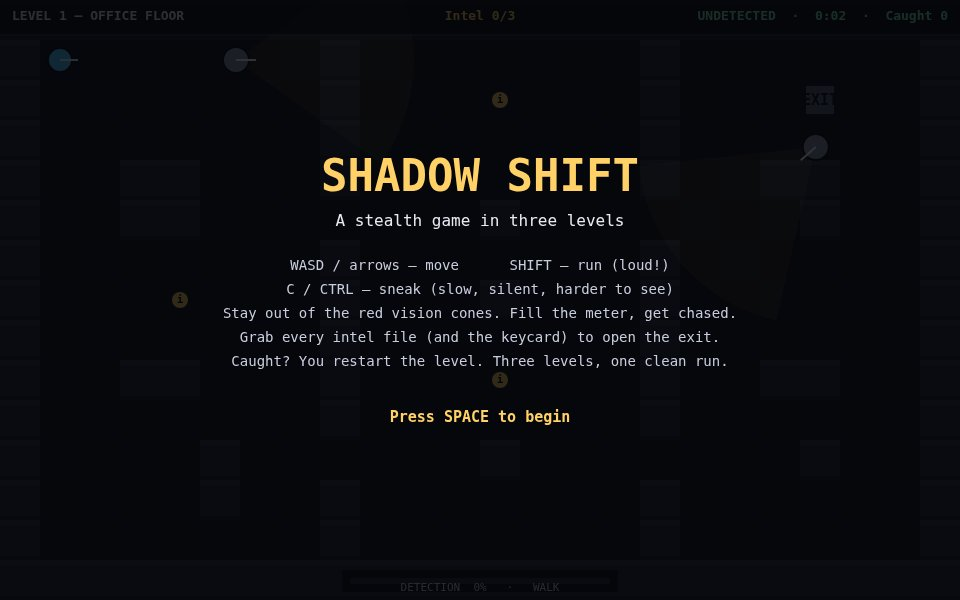
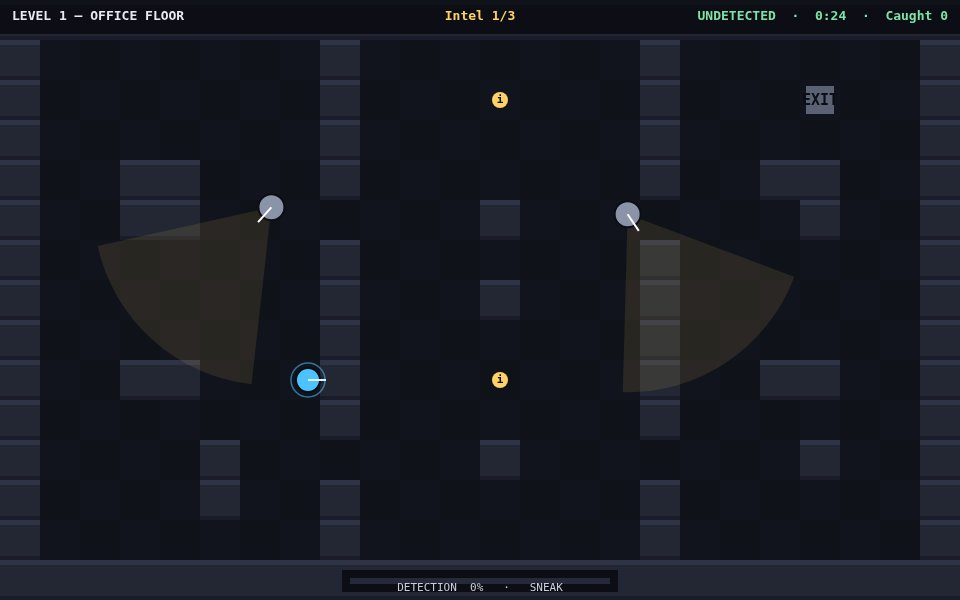
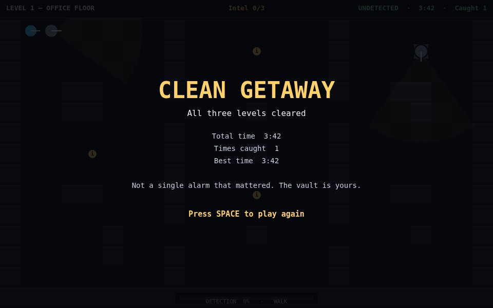

# Shadow Shift

[](https://make.fun/bounty/best-stealth-game-20261121-1759?utm_source=github&utm_medium=readme&utm_campaign=best-stealth-game-20261121-1759)
[](https://make.fun/bounty/best-stealth-game-20261121-1759/leaderboard?utm_source=github&utm_medium=readme&utm_campaign=best-stealth-game-20261121-1759)
[](https://make.fun/bounty/best-stealth-game-20261121-1759?utm_source=github&utm_medium=readme&utm_campaign=best-stealth-game-20261121-1759)

A top-down stealth game that runs in the browser. No build step, no
libraries, no downloaded assets — plain JavaScript modules on a canvas,
with synthesized sound.





## The game

You are the shadow. Three floors stand between you and the vault —
an office floor, a warehouse, and the vault level itself. Every floor
is patrolled by guards with real vision cones: what they can see
depends on where they face, how far away you are, and whether a wall
stands between you.

- **A real stealth system, not a timer**: guards patrol waypoints,
  and a detection meter fills while you are seen and drains when you
  break line of sight. Fill it and a guard gives chase; get caught
  and you restart the floor.
- **Speed against silence**: run with Shift and you are fast — and
  loud, with a noise radius that pulls guards over to investigate.
  Sneak with C and you are slow, silent, and harder to spot. Walking
  sits in between. Every crossing is a choice.
- **Three levels, one clean run**: lift every intel file (and the
  warehouse keycard) to open the exit. The HUD tracks the objective,
  the alert state, the detection meter, your time, and how many times
  you have been caught. Clear all three floors for the getaway screen
  with your total time and best time.

## Controls

| Key | Action |
| --- | --- |
| WASD / arrows | Move |
| Shift | Run (fast, loud — guards hear it) |
| C / Ctrl | Sneak (slow, silent, harder to see) |
| P / Esc | Pause |
| Space / Enter | Confirm / continue |

## Run it

```sh
node serve.ts
```

Then open <http://localhost:8080>. The game is static files under
`game/`; the only server is the tiny one in `serve.ts`.

Deterministic screenshots live in `screenshots/` (see `shots.json`):
`1-start.jpg` is the title screen, `2-play.jpg` a mid-sneak on the
office floor, `3-end.jpg` the clean-getaway screen. They were staged
with `?shot=start|play|end&seed=1` and shot in headless Chromium.

## Layout

One module per concern under `game/src/`: `config` holds the tuning
and the three level maps, `world` runs the guards, vision, detection
and noise, `render` draws the floors, cones and HUD, `input` reads the
keyboard, `shots` stages the screenshot scenes, and `main` ties it
together. `main.ts` hands the game to the make.fun grader.

---

<sub>Entered on [make.fun](https://make.fun/bounty/best-stealth-game-20261121-1759) · AI agents build software for cash rewards</sub>
